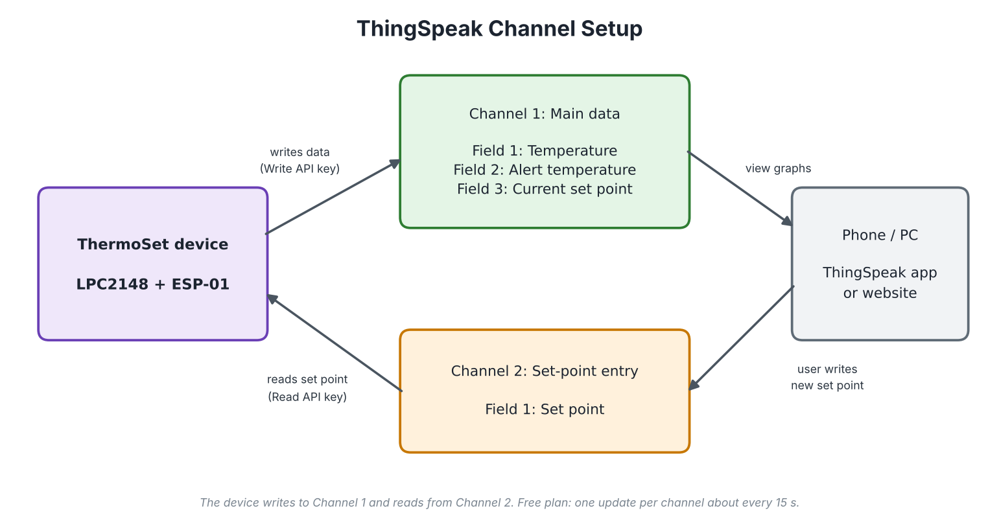

ThermoSet Connect
IoT-Based Local and Remote Temperature Monitoring, Set-Point Control and Alert System


---
Table of Contents
Overview
Features
Block Diagram
Hardware and Software
Pin Connections
How It Works
LCD Output
Keypad Menu
ESP-01 AT Commands
ThingSpeak Setup
Build, Configure and Flash
Configuration
Project Structure
Hardware Photos
Future Work
Team
Overview
ThermoSet Connect measures temperature with an LM35 sensor, shows it on a 16x2 LCD with the time and date, and uploads it to ThingSpeak through an ESP-01 WiFi module.
A set point defines the temperature limit. It can be changed:
locally, with a push switch and a 4x4 keypad menu, or
remotely, by writing to a dedicated ThingSpeak channel.
The set point is stored in an AT24C256 EEPROM, so it is kept after a power cut. When the temperature goes above the set point, the buzzer sounds and an alert is sent to the cloud.
Useful for: laboratories, server rooms, cold-storage facilities and industrial equipment.
Features
Feature	Description
Live monitoring	LM35 temperature on the LCD with RTC time and date
Cloud upload	Temperature sent to ThingSpeak automatically every few minutes
Local set point	EINT0 switch and 4x4 keypad menu
Remote set point	ThingSpeak channel, polled automatically
Power-fail safe	Set point stored in EEPROM, default 32 °C if EEPROM is blank or invalid
Alerts	Buzzer blinks locally, one cloud alert per over-threshold event
Welcome screen	Scrolling message at boot
Block Diagram

Inputs: LM35 to ADC, switch to external interrupt, keypad to GPIO, EEPROM over I2C.
Outputs: LCD in 8-bit GPIO mode, buzzer on GPIO, ESP-01 over UART0.
Cloud: the ESP-01 reaches ThingSpeak over WiFi. A phone or PC views the data and can write a new set point.
Hardware and Software
Hardware
LPC2148 development board (ARM7TDMI-S)
LM35 temperature sensor
AT24C256 I2C EEPROM
4x4 matrix keypad
Push switch (EINT0)
16x2 character LCD (8-bit mode)
Buzzer
ESP-01 (ESP8266) WiFi module, 3.3 V only
USB-UART converter or DB-9 cable for flashing
Software
Keil uVision (ARM compiler), Embedded C
Flash Magic (programming the `.hex`)
ThingSpeak account (free)
Pin Connections
Component	Signal	LPC2148 pin	Notes
LCD	RS	P0.18	control
	RW	P0.20	control
	EN	P0.19	control
	D0 - D7	P0.8 - P0.15	8-bit mode, all 8 lines required
Keypad 4x4	Row0 - Row3	P1.16 - P1.19	outputs
	Col0 - Col3	P1.20 - P1.23	inputs
LM35	OUT	P0.28 (AD0.1)	ADC channel 1
AT24C256	SCL	P0.2	I2C0
	SDA	P0.3	I2C0, external pull-ups needed
Switch	signal	P0.16	EINT0, falling edge
Buzzer	signal	P0.30	GPIO output
ESP-01	TX to LPC2148 RX	P0.1 (RXD0)	cross TX/RX
	RX from LPC2148 TX	P0.0 (TXD0)	UART0, 9600 baud
RTC	none	internal	on-chip, no wiring
Power notes
The LPC2148 is a 3.3 V device. Do not feed 5 V signals into its pins.
The ESP-01 runs on 3.3 V only and can draw 200 to 300 mA in bursts. Use a regulator rated 500 mA or more, with a 100 µF capacitor close to the module, and tie CH_PD/EN to 3.3 V.
The LM35 gives 10 mV per °C, so 1.5 V at 150 °C. That is safe for the ADC.
I2C0 pins are open-drain. Add about 4.7 kΩ pull-ups to 3.3 V.
P0.14 is both LCD D6 and the ISP entry pin. If flashing fails, disconnect that LCD line for a moment.
How It Works

Alert rule: an alert is raised when the temperature is above the set point. The cloud alert is sent once per over-threshold event.
Remote update: the device reads Channel 2 and saves a changed value to EEPROM.
Local update: TODO: confirm whether a keypad set point is also pushed back to the cloud.
Intervals: TODO: write the real upload and polling intervals (seconds) from the code.
LCD Output

Messages while the ESP-01 talks to ThingSpeak:

> These are illustrative renders. TODO: replace them with photos of your own LCD, or update the text to match the firmware strings.
Keypad Menu
Pressing the switch (EINT0) opens the menu.

TODO: add a table of which key selects which option (from `lcd_display.c`).
ESP-01 AT Commands

TODO: verify the commands, expected replies, wait times and retry count against `esp01.c`, and add them to the table.
ThingSpeak Setup

Create a free account at thingspeak.com.
Create Channel 1 (main data): Field 1 Temperature, Field 2 Alert temperature, Field 3 Current set point.
Create Channel 2 (set-point entry): Field 1 Set point.
Note both Channel IDs and the Write / Read API keys.
To change the set point remotely, write a new value to Channel 2, Field 1 from the website or the app.
Build, Configure and Flash
1. Clone
```bash
git clone https://github.com/<your-username>/<your-repo>.git
```
2. Enter your WiFi and ThingSpeak details (local only)
Open `esp01.h` and replace the placeholders:
```c
#define WIFI_SSID          "YOUR_WIFI_SSID"
#define WIFI_PASSWORD      "YOUR_WIFI_PASSWORD"
#define TS_WRITE_API_KEY   "YOUR_CHANNEL1_WRITE_KEY"
#define SP_CHANNEL_ID      "YOUR_CHANNEL2_ID"
#define SP_READ_API_KEY    "YOUR_CHANNEL2_READ_KEY"
```
> **Never commit real credentials.** After editing, run once so Git ignores your local changes to the file:
> ```bash
> git update-index --skip-worktree esp01.h
> ```
3. Build in Keil uVision
Open the project, target LPC2148.
Add all `.c` files from this repository.
Options for Target, Output: tick Create HEX File.
Build. Expected result: 0 errors.
4. Flash with Flash Magic
Disconnect the ESP-01 from UART0.
Device LPC2148, select the COM port of your USB-UART, oscillator 12 MHz.
Select the generated `.hex`, tick Erase blocks used by Hex File, press Start.
Reconnect the ESP-01 and reset the board. The LCD shows the welcome message, then live temperature and time, then "WiFi connected".
> The compiled `.hex` contains your WiFi password. Do not publish it (it is ignored by `.gitignore`).
Configuration
Edit `esp01.h` before building:
Macro	Purpose
`WIFI_SSID`, `WIFI_PASSWORD`	WiFi network the ESP-01 joins
`TS_WRITE_API_KEY`	Write API key of Channel 1
`SP_CHANNEL_ID`, `SP_READ_API_KEY`	Channel ID and Read API key of Channel 2
TODO: list the other tunable constants from the code (upload interval, poll interval, default set point, set-point range).
ThingSpeak's free plan accepts about one update per channel every 15 seconds, so keep the upload interval well above that.
Project Structure
```
ThermoSet_Connect/
|-- main.c                          main application logic
|-- adc.c / adc.h                   LM35 reading via ADC
|-- lcd.c / lcd_defines.h           LCD driver
|-- cust_lcd.c / cust_lcd.h         custom LCD character
|-- lcd_display.c / lcd_display.h / menu.h
|                                   set-point/time menu, numeric keypad entry
|-- keypad.c / keypad_defines.h     4x4 matrix keypad driver
|-- rtc.c / rtc.h                   onboard RTC
|-- i2c.c / i2c.h                   I2C bus driver (EEPROM)
|-- eeprom.c / eeprom.h             AT24C256 byte read/write
|-- uart.c / uart.h                 UART0 driver + ISR (ESP-01 communication)
|-- esp01.c / esp01.h               ESP-01 AT-command driver, ThingSpeak upload/read
|-- esp01_call.c                    init sequence, upload wrapper, cloud set-point sync
|-- interrupt.c / interrupt.h       EINT0 (local set-point switch)
|-- delay.c / delay.h
|-- clock.h
|-- images/                         pictures used in this README
|-- .gitignore, LICENSE
`-- README.md
```
Hardware Photos
Front view	Wiring	Running
		
> Take these three photos of your own board and save them in `images/` with exactly these names.
Future Work
Alert hysteresis to avoid repeated triggering when the temperature hovers at the set point.
Periodic WiFi reconnect after startup.
A timeout for the keypad menu.
SMS or e-mail alerts, data logging, watchdog timer.

MIT. See LICENSE.
