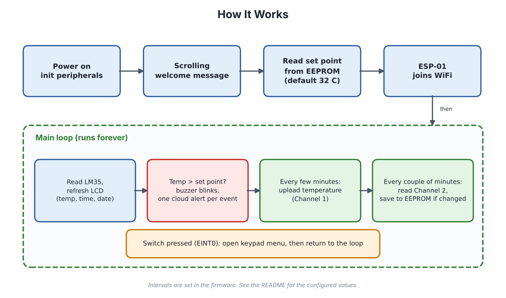
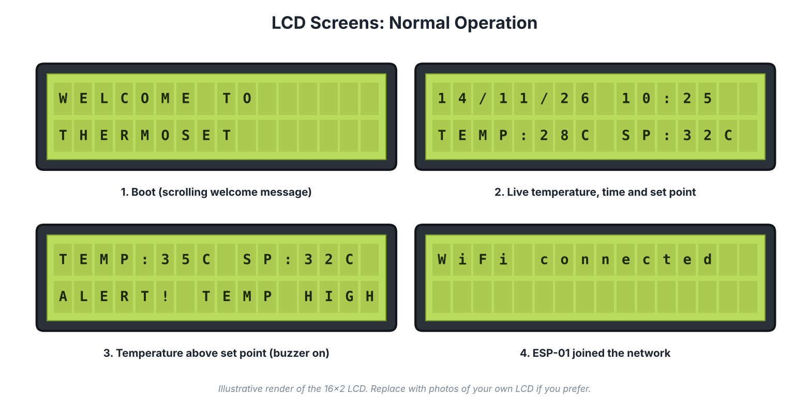
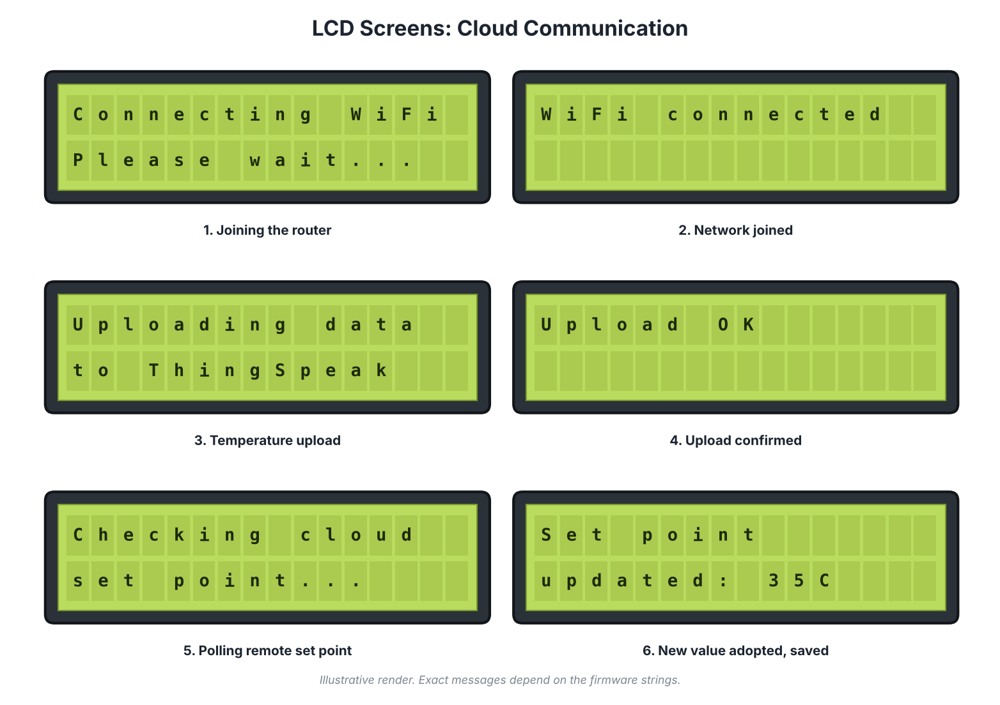
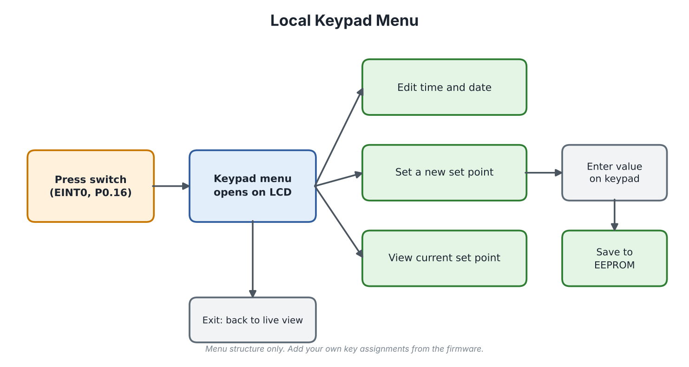
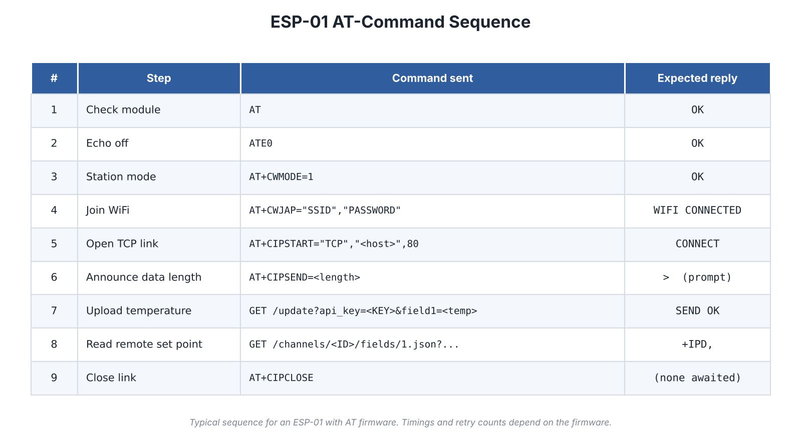

# ThermoSet Connect

### IoT-Based Local and Remote Temperature Monitoring, Set-Point Control and Alert System


---

## Table of Contents

- [Overview](#overview)
- [Features](#features)
- [Block Diagram](#block-diagram)
- [Hardware and Software Requirements](#hardware-and-software-requirements)
- [Pin Connections](#pin-connections)
- [How It Works](#how-it-works)
- [LCD Output](#lcd-output)
- [Keypad Menu](#keypad-menu)
- [ESP-01 AT Commands](#esp-01-at-commands)
- [ThingSpeak Setup](#thingspeak-setup)
- [Build, Configure and Flash](#build-configure-and-flash)
- [Configuration](#configuration)
- [Project Structure](#project-structure)
- [Hardware Photos](#hardware-photos)
- [Future Enhancements](#future-enhancements)
- [License](#license)

---

## Overview

**ThermoSet Connect** is an IoT-based temperature monitoring and control system developed using the LPC2148 ARM7TDMI-S microcontroller.

The system measures temperature using an LM35 temperature sensor and displays real-time temperature, date, and time on a 16x2 LCD.

An ESP-01 WiFi module connects the system to the ThingSpeak cloud platform, allowing temperature data to be monitored remotely.

Users can configure the temperature set point in two ways:

- **Local Control:** Using a push button and a 4x4 matrix keypad.
- **Remote Control:** Updating the set point through a dedicated ThingSpeak channel.

The configured set point is stored in an AT24C256 EEPROM, ensuring that the value is retained even after a power failure.

When the measured temperature exceeds the configured set point, the system activates a buzzer and sends an alert to the cloud.

This project is suitable for applications such as laboratories, server rooms, cold-storage facilities, and industrial equipment monitoring.

## Features

| Feature | Description |
|---|---|
| Temperature Monitoring | Measures temperature using the LM35 sensor. |
| LCD Display | Displays temperature, date, and time on a 16x2 LCD. |
| Cloud Monitoring | Uploads temperature data to ThingSpeak through ESP-01. |
| Local Set-Point Control | Allows users to change the set point using a push button and keypad. |
| Remote Set-Point Control | Allows users to update the set point through ThingSpeak. |
| EEPROM Storage | Stores the set point in AT24C256 EEPROM. |
| Power-Failure Recovery | Retains the configured set point after power interruption. |
| Temperature Alert | Activates a buzzer when temperature exceeds the set point. |
| Cloud Alert | Sends an alert to ThingSpeak when the threshold is exceeded. |
| Welcome Screen | Displays a scrolling welcome message during startup. |

## Block Diagram


### System Components

**Inputs:**
- LM35 temperature sensor connected to ADC.
- Push button connected to external interrupt.
- 4x4 matrix keypad connected through GPIO.
- AT24C256 EEPROM connected through I2C.

**Outputs:**
- 16x2 LCD connected in 8-bit mode.
- Buzzer connected through GPIO.

**Communication:**
- ESP-01 WiFi module connected through UART0.
- ThingSpeak cloud platform for remote monitoring and set-point control.

## Hardware and Software Requirements

### Hardware Requirements

| Component | Purpose |
|---|---|
| LPC2148 Development Board | Main microcontroller |
| LM35 Temperature Sensor | Temperature measurement |
| AT24C256 EEPROM | Non-volatile set-point storage |
| 4x4 Matrix Keypad | Local user input |
| Push Button | External interrupt activation |
| 16x2 LCD | Temperature and status display |
| Buzzer | Temperature alert indication |
| ESP-01 WiFi Module | Wireless cloud communication |
| USB-UART Converter | Microcontroller programming |

### Software Requirements

| Software | Purpose |
|---|---|
| Keil uVision | Embedded C development and compilation |
| Flash Magic | Flashing the generated HEX file |
| Embedded C | Firmware development |
| ThingSpeak | Cloud-based monitoring and control |

## Pin Connections

| Component | Signal | LPC2148 Pin | Description |
|---|---|---|---|
| LCD | RS | P0.18 | Register Select |
| LCD | RW | P0.20 | Read/Write |
| LCD | EN | P0.19 | Enable |
| LCD | D0-D7 | P0.8-P0.15 | 8-bit data lines |
| Keypad | Row0-Row3 | P1.16-P1.19 | Output pins |
| Keypad | Col0-Col3 | P1.20-P1.23 | Input pins |
| LM35 | OUT | P0.28 (AD0.1) | Analog input |
| AT24C256 | SCL | P0.2 | I2C Clock |
| AT24C256 | SDA | P0.3 | I2C Data |
| Push Button | Signal | P0.16 | EINT0 |
| Buzzer | Signal | P0.30 | GPIO Output |
| ESP-01 | TX | P0.1 (RXD0) | UART0 Receive |
| ESP-01 | RX | P0.0 (TXD0) | UART0 Transmit |
| RTC | Internal | On-chip | Real-Time Clock |

### Power Supply Considerations

- LPC2148 operates at 3.3V logic levels. Do not apply 5V signals directly to its pins.
- ESP-01 requires a stable 3.3V supply and can draw approximately 200-300mA during transmission bursts. Use a suitable regulator rated for at least 500mA.
- Place a 100µF capacitor close to the ESP-01 power pins.
- Connect the ESP-01 CH_PD/EN pin to 3.3V.
- LM35 provides an output of approximately 10mV per °C.
- I2C0 requires external pull-up resistors (approximately 4.7kΩ) connected to 3.3V.
- P0.14 is shared between LCD D6 and the ISP entry function. Disconnect the LCD line temporarily if it interferes with flashing.

## How It Works



The system operates through the following sequence:

1. **Initialization:** Initializes the LPC2148 peripherals, LCD, ADC, UART, I2C, RTC, keypad, and EEPROM.
2. **Temperature Measurement:** Reads the analog output of the LM35 through the ADC.
3. **Temperature Display:** Displays the measured temperature along with the RTC date and time on the LCD.
4. **Set-Point Management:** Retrieves the stored temperature set point from EEPROM.
5. **Local Control:** Allows the user to change the set point using the push button and keypad.
6. **Remote Control:** Retrieves an updated set point from ThingSpeak through the ESP-01 module.
7. **EEPROM Storage:** Saves the updated set point in EEPROM.
8. **Cloud Monitoring:** Uploads temperature and related information to ThingSpeak.
9. **Alert Generation:** Activates the buzzer and sends a cloud alert when the temperature exceeds the configured set point.

**Alert Condition:** An alert is generated when the measured temperature exceeds the configured set point.

**Note:** Verify the actual upload interval, cloud polling interval, and local-to-cloud synchronization behavior against the firmware implementation.

## LCD Output



### Cloud Communication Status



The LCD displays system information, including temperature readings, time, date, and WiFi/cloud communication status.

*Note: Replace illustrative LCD renders with actual hardware photographs or update the screenshots to match the firmware output.*

## Keypad Menu

The push button connected to EINT0 activates the menu interface.



The 4x4 matrix keypad allows users to navigate the menu and enter a new temperature set point.

*Note: Add the exact key assignments and menu operations based on the implementation in `lcd_display.c`.*

## ESP-01 AT Commands



The ESP-01 WiFi module communicates with the LPC2148 through UART0 using AT commands.

These commands are used for:

- Checking ESP-01 communication.
- Connecting to a WiFi network.
- Establishing communication with ThingSpeak.
- Uploading temperature data.
- Retrieving the remotely configured set point.

*Note: Verify the exact AT commands, expected responses, delays, and retry mechanisms against `esp01.c`.*

## ThingSpeak Setup


The project uses ThingSpeak for cloud-based temperature monitoring and remote set-point control.

### Channel Configuration

Create a ThingSpeak account and configure the following channels.

**Channel 1 – Temperature Monitoring**

| Field | Description |
|---|---|
| Field 1 | Temperature |
| Field 2 | Alert Temperature |
| Field 3 | Current Set Point |

**Channel 2 – Remote Set-Point Control**

| Field | Description |
|---|---|
| Field 1 | Set Point |

### Configuration Steps

1. Create an account on ThingSpeak.
2. Create Channel 1 for temperature monitoring.
3. Configure the three fields mentioned above.
4. Create Channel 2 for remote set-point control.
5. Note the Channel IDs and API keys.
6. Configure the API keys in `esp01.h`.
7. Update Channel 2, Field 1 to change the set point remotely.

## Build, Configure and Flash

### 1. Clone the Repository

```bash
git clone https://github.com/<your-username>/<your-repo>.git
```

### 2. Configure WiFi and ThingSpeak Credentials

Open `esp01.h` and update the following macros:

```c
#define WIFI_SSID          "YOUR_WIFI_SSID"
#define WIFI_PASSWORD      "YOUR_WIFI_PASSWORD"
#define TS_WRITE_API_KEY   "YOUR_CHANNEL1_WRITE_KEY"
#define SP_CHANNEL_ID      "YOUR_CHANNEL2_ID"
#define SP_READ_API_KEY    "YOUR_CHANNEL2_READ_KEY"
```

**Important:** Never upload actual WiFi passwords or ThingSpeak API keys to a public GitHub repository.

To prevent accidental commits of local changes to `esp01.h`, you can use:

```bash
git update-index --skip-worktree esp01.h
```

### 3. Build Using Keil uVision

1. Open the project in Keil uVision.
2. Select the LPC2148 target.
3. Add all required `.c` source files to the project.
4. Open Options for Target.
5. Navigate to the Output tab.
6. Enable **Create HEX File**.
7. Build the project.

Expected result: Successful compilation with zero errors.

### 4. Flash Using Flash Magic

1. Disconnect the ESP-01 module from UART0.
2. Open Flash Magic.
3. Select LPC2148 as the target device.
4. Select the appropriate COM port.
5. Configure the oscillator frequency to 12 MHz.
6. Select the generated `.hex` file.
7. Enable Erase Blocks Used by Hex File.
8. Start the programming process.
9. Reconnect the ESP-01 module.
10. Reset the LPC2148 board.

After successful programming, the LCD should display the welcome message followed by the temperature, date, time, and WiFi connection status.

**Security Note:** The generated HEX file contains the configured WiFi credentials. Do not publish it in a public repository.

## Configuration

The following macros are configured in `esp01.h`.

| Macro | Purpose |
|---|---|
| `WIFI_SSID` | WiFi network name |
| `WIFI_PASSWORD` | WiFi network password |
| `TS_WRITE_API_KEY` | ThingSpeak Channel 1 Write API Key |
| `SP_CHANNEL_ID` | ThingSpeak Channel 2 ID |
| `SP_READ_API_KEY` | ThingSpeak Channel 2 Read API Key |

Additional firmware configuration parameters, such as upload interval, polling interval, default set point, and set-point range, should be documented after verification.

**ThingSpeak Limitation:** The free ThingSpeak service generally enforces a minimum update interval of 15 seconds per channel. Configure the firmware upload interval accordingly.

## Project Structure

```text
ThermoSet_Connect/
|
|-- main.c
|
|-- adc.c
|-- adc.h
|
|-- lcd.c
|-- lcd_defines.h
|-- cust_lcd.c
|-- cust_lcd.h
|
|-- lcd_display.c
|-- lcd_display.h
|-- menu.h
|
|-- keypad.c
|-- keypad_defines.h
|
|-- rtc.c
|-- rtc.h
|
|-- i2c.c
|-- i2c.h
|
|-- eeprom.c
|-- eeprom.h
|
|-- uart.c
|-- uart.h
|
|-- esp01.c
|-- esp01.h
|-- esp01_call.c
|
|-- interrupt.c
|-- interrupt.h
|
|-- delay.c
|-- delay.h
|-- clock.h
|
|-- image/
|   |-- hw_front.jpg
|   |-- hw_wiring.jpg
|   |-- hw_running.jpg
|   |-- block_diagram.png
|   |-- how_it_works.png
|   |-- lcd_screens.png
|   |-- lcd_cloud_status.png
|   |-- keypad_menu.png
|   |-- at_commands.png
|   |-- thingspeak_channels.png
|
|-- .gitignore
|-- LICENSE
|-- README.md
```

### Source File Description

| File | Description |
|---|---|
| `main.c` | Main application logic |
| `adc.c / adc.h` | ADC configuration and LM35 temperature measurement |
| `lcd.c / lcd_defines.h` | LCD driver |
| `cust_lcd.c / cust_lcd.h` | Custom LCD characters |
| `lcd_display.c / lcd_display.h / menu.h` | LCD display and menu operations |
| `keypad.c / keypad_defines.h` | 4x4 matrix keypad driver |
| `rtc.c / rtc.h` | Real-Time Clock operations |
| `i2c.c / i2c.h` | I2C communication |
| `eeprom.c / eeprom.h` | AT24C256 EEPROM read/write operations |
| `uart.c / uart.h` | UART0 communication and interrupt handling |
| `esp01.c / esp01.h` | ESP-01 AT-command communication and ThingSpeak operations |
| `esp01_call.c` | ESP-01 initialization and cloud communication |
| `interrupt.c / interrupt.h` | External interrupt configuration |
| `delay.c / delay.h` | Delay functions |
| `clock.h` | Clock configuration |

## Hardware Photos

### 1. Front View


### 2. Hardware Connections


### 3. Project in Operation


*Replace these images with actual photographs of the assembled hardware. Keep the filenames unchanged or update the corresponding README image paths.*

## Future Enhancements

The following improvements can be implemented in future versions:

- Implement temperature alert hysteresis to prevent repeated triggering near the set point.
- Add automatic WiFi reconnection when the connection is lost.
- Implement a timeout mechanism for the keypad menu.
- Introduce SMS and email-based temperature alerts.
- Add long-term temperature data logging.
- Implement a watchdog timer for improved system reliability.

## License

This project is licensed under the MIT License.

See the [LICENSE](LICENSE) file for more information.
